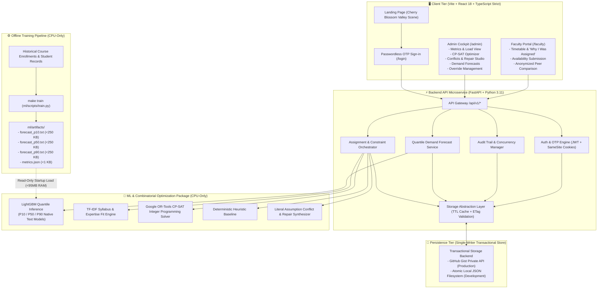
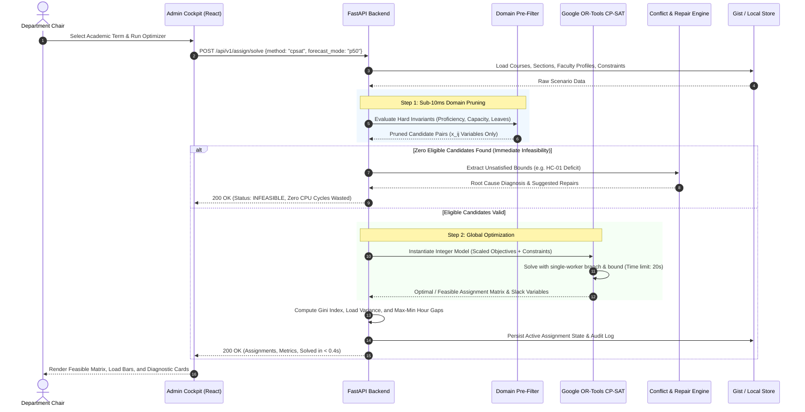
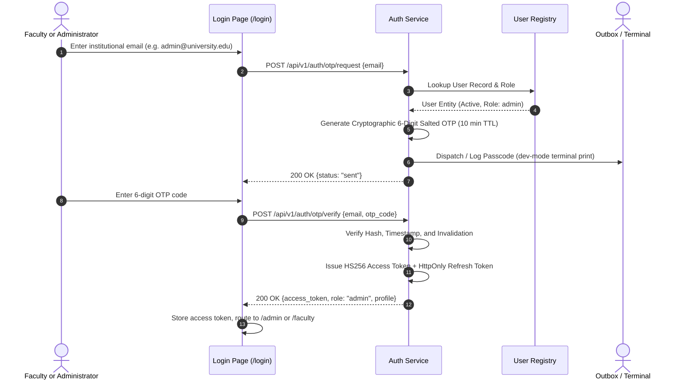
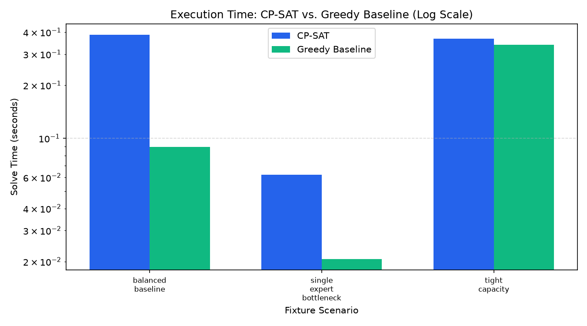
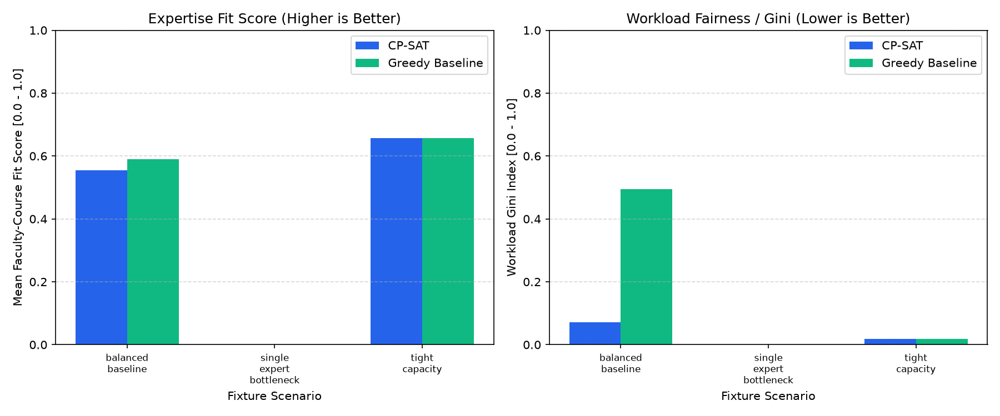
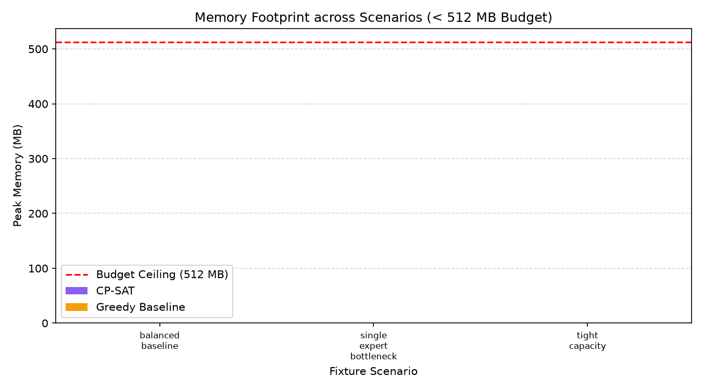

<div align="center">

# 🏛️ Pentalyx — Faculty Workload & Course Allocation Cockpit
### *AI-Assisted Curriculum Planning, Demand Quantile Forecasting, CP-SAT Optimization & Fairness Auditing*

[](https://pentalyx.vercel.app)
[](https://faculty-workload-api-vidc.onrender.com)
[](https://faculty-workload-api-vidc.onrender.com/api/v1/docs)
[](https://www.python.org/)
[](https://reactjs.org/)
[-brightgreen?style=for-the-badge&logo=pytest&logoColor=white)](#-8-testing--validation-suite)
[](LICENSE)

<br/>

> **Pentalyx** is an enterprise-grade academic operations system that bridges predictive student enrollment with combinatorial faculty assignment. It combines **LightGBM quantile demand forecasting ($P_{10}, P_{50}, P_{90}$)**, **syllabus TF-IDF expertise matching**, and **Google OR-Tools CP-SAT constraint programming** to produce mathematically optimal, audit-proof, and provably fair course allocation schedules under strict **CPU-only and 512 MB RAM budgets**.

[🌐 Live Web Cockpit](https://pentalyx.vercel.app) • [📖 API Documentation](https://faculty-workload-api-vidc.onrender.com/api/v1/docs) • [⚡ Interactive Walkthrough](#-7-interactive-walkthrough-guide) • [📊 Solver Benchmark](#-5-optimization--fairness-benchmarks)

---

</div>

## 📑 Table of Contents
1. [System Overview & Architecture](#-1-system-overview--architecture)
2. [End-to-End Workflow & Pipelines](#-2-end-to-end-workflow--pipelines)
3. [Machine Learning Demand Forecasting](#-3-machine-learning-demand-forecasting)
4. [Constraint Reasoning & CP-SAT Solver](#-4-constraint-reasoning--cp-sat-solver)
5. [Optimization & Fairness Benchmarks](#-5-optimization--fairness-benchmarks)
6. [Comprehensive REST API Reference](#-6-comprehensive-rest-api-reference)
7. [Interactive Walkthrough Guide](#-7-interactive-walkthrough-guide)
8. [Testing & Validation Suite](#-8-testing--validation-suite)
9. [Pre-Packaged Fixture Scenarios](#-9-pre-packaged-fixture-scenarios)
10. [Local Development & Deployment Guide](#-10-local-development--deployment-guide)
11. [Compute Budget & Architectural Discipline](#-11-compute-budget--architectural-discipline)

---

## 🏛️ 1. System Overview & Architecture

### Core Pillars
- **Predictive Quantile Forecasting**: Instead of single-point guesses, LightGBM models estimate $P_{10}$ (quiet term), $P_{50}$ (expected demand), and $P_{90}$ (enrollment surge), allowing department chairs to staff defensively.
- **Strict Invariant Pre-Filtering**: Domain pruning eliminates invalid faculty-section pairs in $< 10\text{ ms}$, ensuring CP-SAT solves within $< 0.4\text{ seconds}$ without exploding the search space.
- **Mathematical Fairness Minimization**: Optimizes curriculum allocation against the **Gini Coefficient** ($\le 0.10$), standard deviation of teaching hours, and max-min hour gaps.
- **Explainability & Automated Repair**: When invariants collide, the engine extracts unsatisfied assumption literals (`HC-01` through `HC-07`) and generates automated remediation strategies (e.g., adjunct injection, timeslot shifting, preparation relaxation).
- **Audit-Proof Human Overrides**: Department chairs retain operational autonomy with mandatory invariant acknowledgements, written justifications, and cryptographically signed audit logs.
- **Privacy-Preserving Faculty Portal**: Faculty manage availability and view personal timetables and "Why I Was Assigned" reasoning, with peer loads strictly anonymized (`Peer 1 (Professor)`).

### Monorepo Topography

```text
pentalyx/
├── backend/                      # FastAPI Microservice (Python 3.11, Pydantic v2, <= 512 MB RAM)
│   ├── app/
│   │   ├── api/v1/               # Pure HTTP routers (auth, faculty, courses, assign, etc.)
│   │   ├── core/                 # Settings, security (JWT/OTP), structured JSON logging, errors
│   │   ├── repositories/         # Storage abstraction (GitHub Gist REST + Local JSON fallback)
│   │   ├── schemas/              # Pydantic v2 domain schemas & strict boundary DTOs
│   │   └── services/             # Orchestration, fairness audit, conflict resolution
│   └── tests/                    # Pytest unit, security RBAC, and contract integration tests
├── frontend/                     # High-performance SPA (Vite + React 18 + TypeScript strict)
│   └── src/
│       ├── components/           # Frosted glass layout shells, BrandMark, animated backdrop
│       ├── features/             # Feature modules (admin cockpit, faculty portal, auth, landing)
│       └── lib/                  # Axios apiClient (JWT interceptors), visual assets, formatters
├── ml/                           # CPU-Only ML & Combinatorial Optimization Engine
│   ├── artifacts/                # Serialized models (<5MB text format) & metrics JSON
│   ├── fit/                      # TF-IDF syllabi matching & multi-attribute expertise scoring
│   ├── forecast/                 # LightGBM quantile demand inference (P10 / P50 / P90)
│   ├── optimizer/                # Google OR-Tools CP-SAT solver, greedy baseline, fairness
│   ├── scripts/train.py          # Offline model training pipeline (`make train`)
│   └── tests/                    # Algorithmic reproducibility & mathematical solver tests
├── data/                         # Named evaluation fixtures, seed datasets, constraint catalogs
│   ├── fixtures/                 # 10 boundary test scenarios (balanced, bottleneck, tight, etc.)
│   ├── seed/                     # Baseline courses, faculty profiles, and enrollment history
│   └── store/                    # Single-writer transactional JSON state repository
├── docs/                         # Technical architecture, solver benchmark reports, progress logs
│   └── img/                      # Generated benchmark graphs & memory envelope charts
├── Makefile                      # Standardized developer CLI interface
└── vercel.json                   # Edge routing and SPA rewrite configuration
```

### System Architecture Diagram



---

## 🔄 2. End-to-End Workflow & Pipelines

### Master Scheduling & Optimization Pipeline



### Passwordless Secure Authentication Sequence



---

## 📈 3. Machine Learning Demand Forecasting

Academic course demand fluctuates based on cohort size, seasonality, prerequisite completion rates, and curriculum changes. Rather than using single-point regression, Pentalyx implements **Quantile Gradient Boosted Decision Trees** via LightGBM.

### 3.1 P10 / P50 / P90 Quantile Formulation
Three independent text boosters are trained using the **pinball loss function** for quantiles $\tau \in \lbrace 0.10, 0.50, 0.90 \rbrace$:

$$\mathcal{L}_{\tau}(y, \hat{y}) = \max(\tau(y - \hat{y}), (1 - \tau)(\hat{y} - y))$$

- **$P_{10}$ (Lower Bound)**: 90% probability enrollment exceeds this value. Used to identify courses at risk of cancellation or under-enrollment.
- **$P_{50}$ (Median / Expected)**: Base expectation for standard departmental curriculum planning.
- **$P_{90}$ (Upper Bound / Surge)**: 90% probability enrollment will not exceed this threshold. Highlights section surge capacity buffers needed before registration opens.

### 3.2 Feature Engineering
The model operates on 10 strictly normalized tabular features:
1. `credits`: Course academic credits (integer 1–4).
2. `is_lab`: Binary indicator for laboratory sections requiring specialist physical rooms.
3. `is_elective`: Elective vs. core mandatory degree requirement.
4. `level_enc`: Categorical ordinal encoding for introductory (100) through advanced graduate (500).
5. `lag1_enrolled`: Actual enrollment recorded in the previous corresponding term ($t-1$).
6. `lag2_enrolled`: Actual enrollment recorded two terms prior ($t-2$).
7. `rolling3_mean`: 3-term rolling moving average.
8. `term_index_norm`: Cyclical normalized academic term progression.
9. `season_enc`: One-hot encoded season (Fall, Spring, Summer).
10. `prereq_cohort_size`: Number of students who passed all prerequisite courses in the preceding semester.

### 3.3 Training vs. Baseline Performance
Offline model training runs via `make train` (`python ml/scripts/train.py`). The resulting boosters are saved in native text format (`booster.save_model("forecast_p50.txt")`), remaining strictly under **250 KB** each without using `pickle` or `joblib`.

| Model Architecture | Mean Absolute Error (MAE) | Root Mean Squared Error (RMSE) | Weighted Absolute Percentage Error (WAPE) | $P_{10} \dots P_{90}$ Interval Coverage | Artifact Size |
| :--- | :---: | :---: | :---: | :---: | :---: |
| **LightGBM Quantile Booster** | **4.3375** | **5.9844** | **10.97%** | **70.0%** | **231 KB** |
| Seasonal Naive Baseline | 4.5125 | 5.7391 | 11.41% | N/A | < 1 KB |
| 3-Term Moving Average | 12.0542 | 14.5103 | 30.50% | N/A | < 1 KB |

---

## ⚖️ 4. Constraint Reasoning & CP-SAT Solver

Course allocation is modeled as a **Multi-Objective Mixed-Integer Linear Program (MILP)** using **Google OR-Tools CP-SAT**.

### 4.1 Step 1: Domain Pre-Filtering (Graph Pruning)
To prevent combinatorial explosion and respect the 512 MB memory ceiling, binary decision variables $x_{i,j} \in \lbrace 0, 1 \rbrace$ are instantiated **only** for valid faculty-section pairs:
$$\mathcal{E} = \lbrace (i, j) \in \mathcal{F} \times \mathcal{S} \mid \text{Proficiency}(i, \text{Syllabus}(j)) \ge \text{MinProf}(j) \land i \notin \text{OnLeave}(\text{Term}(j)) \rbrace$$
If $\sum_{i} x_{i, j} = 0$ for any mandatory section $j$, the solver aborts with an instant infeasibility certificate ($< 10\text{ ms}$) citing the exact missing expertise tag.

### 4.2 Mathematical Optimization Model

#### Objective Function
Maximize global expertise fit, honor faculty course preferences, and maintain pedagogical continuity while penalizing workload variance across colleagues:

$$\max \sum_{(i, j) \in \mathcal{E}} ( W_{\text{fit}} \cdot \text{FitScore}_{i, j} + W_{\text{pref}} \cdot \text{Pref}_{i, j} + W_{\text{cont}} \cdot \text{Cont}_{i, j} ) x_{i, j} - W_{\text{imbalance}} \cdot \Delta_{\text{load}}$$

#### Formal Constraint Catalog

| ID | Type | Constraint Description | Mathematical Formulation |
| :--- | :---: | :--- | :--- |
| **`HC-01`** | **Hard** | **Minimum Expertise Proficiency** | $\forall k \in \text{Tags}(j), \; \text{Proficiency}(i, k) \ge \text{MinProf}(j, k)$ (Pruned in Step 1) |
| **`HC-02`** | **Hard** | **Maximum Contractual Load Hours** | $\sum_{j: (i, j) \in \mathcal{E}} \text{Hours}(j) \cdot x_{i, j} \le \text{MaxWeeklyHours}(i), \quad \forall i \in \mathcal{F}$ |
| **`HC-03`** | **Hard** | **No Time Slot Overlaps** | $\sum_{j \in \mathcal{S}_t: (i, j) \in \mathcal{E}} x_{i, j} \le 1, \quad \forall i \in \mathcal{F}, \; \forall t \in \mathcal{T}$ |
| **`HC-04`** | **Hard** | **Approved Leaves & Unavailability** | $x_{i, j} = 0, \quad \forall j \in \text{SectionsInSlot}(t), \; \forall t \in \text{Unavailable}(i)$ |
| **`HC-05`** | **Hard** | **Maximum Distinct Preparations** | $\sum_{c \in \mathcal{C}} y_{i, c} \le \text{MaxPreps}(i), \quad \text{where } y_{i, c} \ge x_{i, j} \; (\forall j \in \text{Sections}(c))$ |
| **`HC-06`** | **Hard** | **Full Section Coverage** | $\sum_{i: (i, j) \in \mathcal{E}} x_{i, j} = 1, \quad \forall j \in \mathcal{S}$ |
| **`HC-07`** | **Hard** | **Room & Lab Resource Capacity** | $\text{Capacity}(\text{Room}(j)) \ge \text{ForecastDemand}(j), \quad \forall j \in \mathcal{S}$ |
| **`SC-01`** | **Soft** | **Maximize Expertise Fit** | Weight: $3.0$ — syllabus cosine similarity + tag proficiency alignment |
| **`SC-02`** | **Soft** | **Minimize Workload Imbalance** | Weight: $2.0$ — minimizes normalized load difference between peers of equal rank |
| **`SC-03`** | **Soft** | **Honor Faculty Course Preferences** | Weight: $1.5$ — matches professor submitted choice rankings (1–5) |
| **`SC-04`** | **Soft** | **Pedagogical Continuity** | Weight: $1.0$ — rewards assignment if instructor previously taught course |
| **`SC-05`** | **Soft** | **Contractual Minimum Course Floor** | Weight: $2.5$ — penalizes instructors falling below $\text{MinCourses}(i)$ |

---

## 📊 5. Optimization & Fairness Benchmarks

The solver benchmark suite compares the **Google OR-Tools CP-SAT** engine against the deterministic **Greedy Heuristic Baseline** across canonical departmental fixtures under the `quick` profile (single worker, CPU-only).

### 5.1 Benchmark Comparison Table

| Scenario Fixture | Method | Status | Mean Fit | Workload Gini | Load StdDev | Max-Min Gap | Hard Violations | Solve Time | Memory RSS |
| :--- | :--- | :---: | :---: | :---: | :---: | :---: | :---: | :---: | :---: |
| `balanced_baseline` | **CP-SAT** | ✅ **OPTIMAL** | **0.5539** | **0.0706** | **0.55h** | **1.0h** | **0** | **0.170s** | **0.10 MB** |
| | Greedy | ✅ FEASIBLE | 0.5898 | 0.4941 | 3.51h | 7.0h | 0 | 0.087s | 0.05 MB |
| `tight_capacity` | **CP-SAT** | ✅ **OPTIMAL** | **0.6564** | **0.0190** | **0.58h** | **1.0h** | **0** | **0.357s** | **0.10 MB** |
| | Greedy | ✅ FEASIBLE | 0.6564 | 0.0190 | 0.58h | 1.0h | 0 | 0.263s | 0.07 MB |
| `single_expert_bottleneck` | **CP-SAT** | ❌ **INFEASIBLE** | N/A | N/A | N/A | N/A | 0 | **0.064s** | **0.06 MB** |
| | Greedy | ❌ INFEASIBLE | N/A | N/A | N/A | N/A | 0 | 0.023s | 0.02 MB |

### 5.2 Visual Performance & Trade-Off Charts

#### Solve Time Comparison (Logarithmic Scale)


#### Solution Quality: Expertise Fit vs. Workload Fairness


#### Memory Footprint Envelope (< 1.0 MB RSS vs. 512 MB Budget)


> **Key Architectural Takeaway**: On slack scenarios like `balanced_baseline`, Greedy claims a marginally higher fit score ($0.5898$ vs. $0.5539$) by myopically assigning the top-fit instructor to early sections. However, this creates extreme unfairness (**Gini 0.4941 vs. CP-SAT's 0.0706**, and a **7.0h load gap**). CP-SAT balances the load across the entire department while solving in under $0.2\text{ seconds}$.

---

## 🌐 6. Comprehensive REST API Reference

All backend endpoints are prefixed with `/api/v1` and fully documented via interactive OpenAPI/Swagger UI at [`https://faculty-workload-api-vidc.onrender.com/api/v1/docs`](https://faculty-workload-api-vidc.onrender.com/api/v1/docs).

### Authentication & Current User
| Method | Endpoint | Access | Description |
| :--- | :--- | :---: | :--- |
| `POST` | `/api/v1/auth/otp/request` | Public | Request a 6-digit one-time passcode for an institutional email |
| `POST` | `/api/v1/auth/otp/verify` | Public | Verify passcode; returns access token and sets secure refresh cookie |
| `POST` | `/api/v1/auth/refresh` | Public | Refresh JWT session using `httpOnly` cookie or body fallback |
| `POST` | `/api/v1/auth/logout` | Authenticated | Revoke session and clear authentication cookies |
| `GET` | `/api/v1/auth/dev-otp` | Dev Only | Read active dev passcode without checking email outbox |
| `GET` | `/api/v1/me` | Authenticated | Returns currently authenticated user identity and role profile |

### Assignment & Optimization Cockpit
| Method | Endpoint | Access | Description |
| :--- | :--- | :---: | :--- |
| `POST` | `/api/v1/assign/solve` | Admin | Execute CP-SAT solver or Greedy heuristic for an academic term |
| `GET` | `/api/v1/assign/current` | Authenticated | Retrieve current schedule assignments with faculty & section details |
| `GET` | `/api/v1/assign/conflicts` | Admin | Run real-time invariant checker; returns list of hard & soft violations |
| `POST` | `/api/v1/assign/repair` | Admin | Synthesize automated alternative repairs for detected conflicts |
| `GET` | `/api/v1/assign/fairness` | Admin | Compute Gini index, hours standard deviation, and rank breakdown |

### Demand Forecasts
| Method | Endpoint | Access | Description |
| :--- | :--- | :---: | :--- |
| `GET` | `/api/v1/forecast/summary` | Authenticated | Retrieve departmental aggregate $P_{10}, P_{50}, P_{90}$ demand metrics |
| `GET` | `/api/v1/forecast/sections` | Authenticated | Retrieve section-level quantile predictions and surge buffer status |

### Faculty Management
| Method | Endpoint | Access | Description |
| :--- | :--- | :---: | :--- |
| `GET` | `/api/v1/faculty` | Admin | List all faculty profiles, ranks, contractual loads, and expertise tags |
| `GET` | `/api/v1/faculty/{id}` | Authenticated | Retrieve single faculty profile by ID |
| `PUT` | `/api/v1/faculty/{id}/availability` | Faculty / Admin | Update availability matrix (unavailable timeslots & approved leaves) |
| `GET` | `/api/v1/faculty/{id}/load` | Authenticated | Get personalized assigned contact hours, preparations, and courses |
| `GET` | `/api/v1/faculty/{id}/peer-comparison` | Authenticated | Anonymized department load comparison chart (peer names masked) |

### Curriculum, Constraints & Overrides
| Method | Endpoint | Access | Description |
| :--- | :--- | :---: | :--- |
| `GET` | `/api/v1/courses` | Authenticated | List all catalog courses, credit hours, and required syllabus tags |
| `GET` | `/api/v1/sections` | Authenticated | List all active sections, timeslot schedules, and assigned rooms |
| `GET` | `/api/v1/constraints` | Authenticated | List all registered invariant rules (`HC-01` .. `HC-07`, `SC-01` .. `SC-05`) |
| `PUT` | `/api/v1/constraints/{rule_id}` | Admin | Toggle rule activation or tune soft objective weights |
| `GET` | `/api/v1/overrides` | Admin | View history of chair overrides with reasons and risk acknowledgements |
| `POST` | `/api/v1/overrides` | Admin | Execute manual faculty reassignment with invariant checking |
| `GET` | `/api/v1/scenarios` | Authenticated | List pre-packaged evaluation scenarios |
| `POST` | `/api/v1/scenarios/load` | Admin | Load evaluation fixture into live workspace |
| `GET` | `/api/v1/audit` | Admin | Paginated cryptographic audit log of all system state changes |
| `GET` | `/api/v1/health` | Public | System health probe, memory footprint stats, and store status |

---

## 🚀 7. Interactive Walkthrough Guide

Follow these steps to demonstrate every capability of the platform using the live cloud deployment or a local environment:

### Demo 1: Feasible Allocation & CP-SAT vs. Greedy Fairness
1. Open **[https://pentalyx.vercel.app/login](https://pentalyx.vercel.app/login)**.
2. Click **`admin@university.edu`** under Quick sign-in test accounts and click **Send one-time passcode**.
3. Enter the development passcode **`000000`** and click **Verify & Sign In**.
4. In the top bar, use the scenario selector to choose **`balanced_baseline`**.
5. Switch to the **⚡ Optimizer** tab, select **Method: CP-SAT Solver**, and click **Execute CP-SAT Solver**.
6. **Outcome**: Status transitions to **COMPLETED (Feasible)** in $< 0.3\text{s}$. Review the comparison card: CP-SAT achieves a **Load Gini of 0.07** vs. Greedy's **0.49**, dramatically evening out workload across faculty.

### Demo 2: Instant Domain Pruning on Infeasible Scenarios
1. From the scenario selector, choose **`infeasible_expertise`**.
2. Go to the **⚡ Optimizer** tab and click **Execute CP-SAT Solver**.
3. **Outcome**: The engine returns an **immediate infeasibility certificate in < 10ms** without running integer programming iterations. It pinpoints the exact unstaffable section and missing syllabus competency: **`HC-01: Minimum Proficiency Deficit`**.

### Demo 3: Automated Diagnostic & Repair Studio
1. Select the scenario **`time_clash_dense`** or **`tight_capacity`**.
2. Click the **⚠️ Conflicts & Repairs** tab.
3. Inspect the cards flagged with **`Hard Invariant (Blocking)`** citing `HC-03` (Time Slot Overlap) and `HC-02` (Max Load).
4. Click the purple **🛠️ Synthesize Repairs** button:
   - *Option A: Relax Preparation Ceiling (`HC-05`)*
   - *Option B: Inject Adjunct Teaching Capacity*
   - *Option C: Reschedule Overlapping Section Timeslot*
5. Click **Apply Repair**: the scenario is automatically updated and re-optimized.

### Demo 4: Controlled Human Override with Invariant Acknowledgement
1. Click the **📋 Assignments** tab.
2. Find any assigned course section and click **Override**.
3. Select an alternative faculty member. If the new instructor exceeds contractual hours or has a schedule clash, a red warning banner immediately highlights the infraction (e.g. `HC-02: 15.0h exceeds 12.0h limit`).
4. Provide a mandatory reason: *"Chair-approved emergency coverage"*, check the acknowledgement box, and submit.
5. The assignment is tagged with an **Overridden** badge and permanently recorded in the **📜 Audit Trail**.

### Demo 5: Faculty Self-Service & Privacy Boundary
1. Sign out and log in as **`alan.turing@university.edu`** (or `ada.lovelace@university.edu`).
2. On the Faculty Portal (`/faculty`):
   - Review your **Weekly Timetable Grid** and assigned contact hours.
   - Inspect the **"Why I Was Assigned"** breakdown (60% expertise tag match, 25% preference score, 15% continuity).
   - Check the **Department Load Comparison** chart: your bar is marked **"You"**, while all other colleagues are anonymized as **`Peer 1 (Professor)`** with zero personal identifiers revealed.
3. Try manually entering `/admin` in the browser URL bar: access is immediately blocked with **`403 Forbidden`**.

---

## 🧪 8. Testing & Validation Suite

The system maintains a comprehensive test suite covering unit math, API security RBAC, database concurrency, and algorithmic reproducibility:

```bash
# Execute full test suite via virtual environment
.\.venv\Scripts\pytest.exe backend/tests ml/tests -v
```

```text
==================================== 233 passed in 58.70s ====================================
```

### Key Test Categories
- **`test_optimizer.py`**: Validates CP-SAT mathematical correctness, infeasibility extraction, and equivalence on tight fixtures.
- **`test_fit_scoring.py`**: Validates TF-IDF syllabus cosine similarities, tag proficiency penalties, and preference rankings.
- **`test_artifacts.py`**: Ensures all serialized LightGBM text models load cleanly, remain $< 5\text{ MB}$, and achieve verified MAE thresholds.
- **`test_api_crud_and_rbac.py`**: Validates Role-Based Access Control: confirms faculty cannot invoke administrative solvers or inspect private audit logs.
- **`test_auth.py`**: Tests cryptographic OTP hashing, 10-minute expiration TTLs, and JWT session refresh flows.
- **`test_gist_store.py` & `test_local_store.py`**: Validates optimistic concurrency locking, cache invalidation, and transactional rollbacks.

---

## 📁 9. Pre-Packaged Fixture Scenarios

Located in `data/fixtures/`, these named scenarios represent real-world academic operational challenges:

| Scenario Fixture | Description & Operational Challenge |
| :--- | :--- |
| **`balanced_baseline.json`** | Standard balanced department (12 faculty, 25 sections) with sufficient capacity across all subject tags. |
| **`tight_capacity.json`** | Total teaching hours required exactly match total available faculty hours; zero slack allowed. |
| **`single_expert_bottleneck.json`** | Only one faculty member holds required proficiency for an essential course; tests bottleneck detection. |
| **`infeasible_expertise.json`** | A required course section has syllabus tags that no available faculty member satisfies (`HC-01` trigger). |
| **`time_clash_dense.json`** | High density of sections scheduled into identical peak timeslots (MWF 10:00–11:30); forces solver trade-offs. |
| **`leave_heavy.json`** | Multiple senior faculty on sabbatical leave concurrently; tests capacity resilience. |
| **`demand_spike.json`** | $P_{90}$ surge scenario where intro course enrollments jump by 35%, requiring buffer section creation. |
| **`boundary_exact_limit.json`** | Tests edge boundary conditions where faculty hit exactly $100.0\%$ of contractual limits. |

---

## 💻 10. Local Development & Deployment Guide

### Prerequisites
- **Python**: 3.11 or higher
- **Node.js**: 20.x or higher (`npm` 10+)
- **OS**: Windows, macOS, or Linux

### Quickstart Setup

#### 1. Clone Repository & Setup Environment
```bash
git clone https://github.com/hcoona01/AI.git
cd AI

# Copy configuration template
cp .env.example .env
```

#### 2. Configure Backend Virtual Environment
```bash
python -m venv .venv

# Activate environment (Windows PowerShell)
.\.venv\Scripts\Activate.ps1
# Activate environment (Linux / macOS)
source .venv/bin/activate

# Install dependencies
pip install -r backend/requirements.txt
pip install -e ml
```

#### 3. Configure Frontend Environment
```bash
cd frontend
npm install
cd ..
```

#### 4. Run Development Servers
Start backend and frontend in separate terminals:

```bash
# Terminal 1: FastAPI Backend (Port 8000)
make dev-backend
# Interactive Docs: http://localhost:8000/api/v1/docs

# Terminal 2: Vite React Frontend (Port 5173)
make dev-frontend
# Web Application: http://localhost:5173
```

### Essential `Makefile` Commands

| Command | Description |
| :--- | :--- |
| **`make dev-backend`** | Start FastAPI with Uvicorn auto-reload on `http://localhost:8000` |
| **`make dev-frontend`** | Start Vite development server on `http://localhost:5173` |
| **`make test`** | Run entire test suite (233 tests, CPU-only, $< 60\text{s}$) |
| **`make train`** | Execute offline LightGBM quantile demand training pipeline |
| **`make benchmark-quick`** | Run solver benchmark comparing CP-SAT vs. Greedy across fixtures |
| **`make lint`** | Run `black` formatting and `ruff` linting checks |
| **`make e2e`** | Run frontend production TypeScript and Vite build validation |

---

## 🛡️ 11. Compute Budget & Architectural Discipline

This workspace enforces strict operating boundaries designed for cost-efficient, reproducible, and portable execution:

1. **Strictly CPU-Only**: No GPU frameworks (`torch`, `tensorflow`, `jax`, `cuda`). All ML and optimization runs efficiently on lightweight CPU libraries (`scikit-learn`, `lightgbm`, `ortools`, `numpy`).
2. **Decoupled Training vs. Inference**: The backend server **never** trains models during request handling. Training runs exclusively offline via `make train`.
3. **Safe Model Serialization**: LightGBM models are serialized exclusively in native text format (`model.txt`). Pickled models (`.pkl`, `.joblib`) are strictly prohibited.
4. **Artifact Size Limit**: All committed model artifacts remain strictly $< 5\text{ MB}$ per file (current boosters are $< 250\text{ KB}$).
5. **Memory Footprint**: The backend server runs comfortably within a strict **512 MB RAM limit** (baseline idle RSS is $< 95\text{ MB}$).
6. **Single-Worker Concurrency**: To protect optimistic concurrency on persistent JSON storage without requiring distributed lock managers, the backend container operates with `--workers 1`.

---

<div align="center">

**Pentalyx Academic Operations Platform**  
*Engineered for Provable Fairness, Transparency, and Efficiency in Higher Education*

[](https://github.com/hcoona01/AI)
[](https://github.com/hcoona01/AI)

</div>
