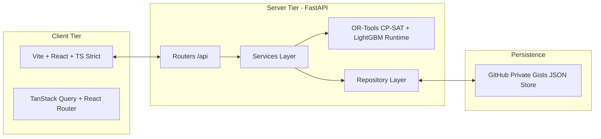

# Project Brief: University Faculty Workload & Course Assignment Balancing System

## 1. Executive Summary

| Attribute | Specification |
| :--- | :--- |
| **Project** | University Faculty Workload and Course Assignment Balancing System |
| **Domain Skills** | AI/ML Engineering + Full Stack Development |
| **Core Need** | An AI-assisted faculty-allocation system that integrates demand prediction, constraint reasoning, and fairness analysis. It connects expected course demand with practical workload balancing and makes assignment constraints and trade-offs visible to department planners. |

---

## 2. Target Outcomes

1. **Structured Assignment Constraints & Reproducible Benchmark Scenarios**
   - Model faculty expertise, course requirements, expected section sizes, and workload limits as formal, structured assignment constraints.
   - Include representative constraint combinations, unavailable resources, and realistic boundary/edge cases so the planning model can be benchmarked and evaluated reproducibly.

2. **Demand Forecasting & Constraint-Based Optimization with Baseline Comparison**
   - Forecast course/section demand with quantile estimates (P10, P50, P90).
   - Integrate demand forecasts into a constraint-based assignment engine that balances expertise fit and workload fairness.
   - Compare feasibility, objective quality, and computational overhead against a greedy baseline, documenting explicit trade-offs before selecting the final approach.

3. **Explainable Departmental Planning Tool & Controlled Human Overrides**
   - Deploy an administrative planning interface showing assigned teaching loads, conflicts, forecast uncertainty, and the underlying rules responsible for recommended assignments.
   - Deliver clear conflict explanations, automated repair alternatives, and controlled human overrides so department chairs/administrators can adjust assignments without losing auditability or constraint evidence.

---

## 3. Technology Stack (Strict / Non-negotiable)

### 3.1 Frontend
- **Framework & Tooling**: Vite + React with TypeScript (`strict: true`).
- **State & Routing**: TanStack Query (server state cache), React Router.
- **Validation & Components**: Zod schemas for forms and API responses; accessible semantic UI components (Vanilla CSS / modern design tokens).

### 3.2 Backend
- **Framework**: FastAPI (Python 3.11).
- **Data Modeling & Validation**: Pydantic v2.
- **Layering Pattern**: Strict `api (routers) -> services -> repositories` separation. No business logic in routers.
- **Code Quality & Testing**: Type hints throughout, formatted with `ruff` + `black`, tested with `pytest`.
- **Resource Envelope**: Must run within a 512 MB RAM footprint.

### 3.3 Database & Storage
- **Mechanism**: GitHub Gists via GitHub REST API (private Gist containing versioned JSON files).
- **Limitations Handled**:
  - Gist lack of transactions handled via optimistic concurrency control (ETag / revision tracking).
  - API rate limits mitigated by local caching and minimal write passes.
  - Large file handling: Files > 1 MB truncated in Gist API responses are retrieved via `raw_url`.
  - Conflict resolution: Detection of concurrent write collisions with clean recovery.

### 3.4 Authentication & RBAC
- **Authentication**: Passwordless Email OTP login.
- **Role-Based Access Control (RBAC)**:
  - **Admin / Department Chair**: Full optimization control, override authority, constraint parameterization, Gist store management.
  - **Faculty**: Read assigned schedules, submit preference tags, review expertise matches, submit availability exceptions.

### 3.5 AI / ML (CPU-Only & Lightweight)
- **Demand Forecasting**: LightGBM quantile regression ($P_{10}, P_{50}, P_{90}$) predicting section enrollments.
- **Expertise Fit**: Tag-based overlap and TF-IDF similarity between faculty research/teaching profiles and course syllabi/descriptions.
- **Constraint Solver**: Google OR-Tools CP-SAT for multi-objective optimization (expertise fit, workload balance, schedule feasibility).
- **Baseline Algorithm**: Deterministic greedy heuristic for quality, speed, and feasibility comparison.
- **Execution Boundary**: Zero backend training. Training is executed strictly via local offline script (`make train` $\rightarrow$ `python ml/scripts/train.py`). The backend only loads small, precomputed artifacts.

---

## 4. Key Architectural & Design Decisions

### 4.1 Explainability via Stable Rule IDs
- Every constraint, objective component, and hard/soft rule has a persistent, documented identifier (e.g., `HC-01_MAX_LOAD`, `HC-02_TIME_CONFLICT`, `SC-01_EXPERTISE_MATCH`, `SC-02_LOAD_FAIRNESS`).
- Every solver decision, conflict warning, repair suggestion, and manual override explicitly references these `rule_id` values, ensuring full traceability and user trust.

### 4.2 Forecast Uncertainty in Planning
- Demand forecasts output quantile estimates:
  - **P10**: Conservative baseline / minimum enrollment scenario.
  - **P50**: Median expected demand (default planning mode).
  - **P90**: High-demand stress scenario (risk mitigation mode).
- Department planners can toggle between P50 and P90 demand profiles to inspect workload and section viability under uncertainty.

### 4.3 Quantitative Fairness Verification
Fairness is rigorously quantified rather than assumed. Every schedule solution calculates and displays:
- **Gini Coefficient** of workload distribution across equivalent faculty ranks.
- **Standard Deviation** of assigned credit/section hours.
- **Max-Min Load Gap** across department members.

### 4.4 Auditable Human Overrides
- Administrators may manually reassign sections or adjust loads.
- Overrides require a mandatory textual reason, trigger immediate re-validation against all hard/soft constraints, and are preserved alongside the original automated recommendation without overwriting optimizer evidence.

### 4.5 Security & Secret Segregation
- The GitHub personal access token (PAT), session signing secrets, and OTP credentials reside strictly on the backend via environment variables.
- Secrets are never exposed to the client, checked into source control, or embedded in Gist contents.

### 4.6 Gist Resilience & Concurrency Guardrails
- Backend repositories encapsulate Gist API operations with exponential backoff on HTTP 429/503.
- Reads fetch raw contents directly if truncated flag is set.
- Payload size monitoring guarantees JSON documents remain lean and compact.
