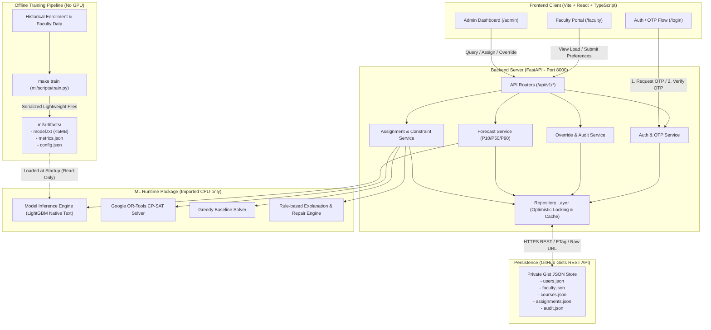
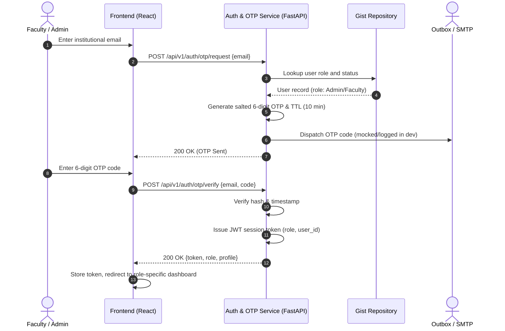

# System Architecture: Faculty Workload & Course Assignment Balancing System

## 1. Architectural Overview

The system is organized as a modular, CPU-optimized monorepo separating client interaction, API orchestration, persistent data access, and offline machine learning pipelines.



---

## 2. Layer Descriptions

### 2.1 Client Tier (`frontend/`)
- **Technology**: Vite, React 18, TypeScript (strict mode), TanStack Query, React Router, Zod.
- **Responsibility**: Provides responsive, accessible interfaces for both administrative planners and faculty members.
- **Role Isolation**:
  - **Admin**: Workload balancing dashboard, quantile demand view, solver configuration, conflict inspection, override controls, and audit history.
  - **Faculty**: Personal teaching schedule, load indicators, expertise tags, and availability submission.

### 2.2 Backend API Tier (`backend/app/`)
- **Technology**: FastAPI, Python 3.11, Pydantic v2.
- **Strict Layering**:
  - `api/v1/`: Pure HTTP translation, query validation, and routing. No business logic.
  - `services/`: Business orchestration, constraint enforcement, solver invocation, OTP verification, and audit logging.
  - `repositories/`: Data access abstraction handling Gist read/write, cache invalidation, ETag handling, and raw file downloads.
- **Memory Footprint**: Strictly constrained within 512 MB RAM.

### 2.3 ML Package (`ml/`)
- **Import Strategy**: Consumed directly by the backend as an importable package (via `pip install -e ml` or `PYTHONPATH=../ml` configuration).
- **Core Modules**:
  - `ml/forecast/`: Lightweight inference for section enrollment quantiles ($P_{10}, P_{50}, P_{90}$).
  - `ml/fit/`: TF-IDF syllabus matching and tag-overlap scoring between faculty profiles and course requirements.
  - `ml/optimizer/`: Constraint satisfaction via Google OR-Tools CP-SAT (single worker, pruned candidate pairs) alongside a deterministic greedy baseline.
  - `ml/optimizer/explain.py`: Maps solver status and slack variables back to human-readable `rule_id` references.

### 2.4 Offline ML Training Pipeline (`ml/scripts/train.py`)
- **Decoupled Training**: The FastAPI runtime **never** executes model training.
- **Execution**: Triggered manually or via pipeline through `make train`.
- **Artifact Contract**: Generates portable, text-based LightGBM models (`booster.save_model("model.txt")`) and human-readable JSON configs/metrics strictly under 5 MB per file in `ml/artifacts/`.
- **Startup Loading**: FastAPI reads `ml/artifacts/` once during startup in a read-only, memory-efficient manner.

### 2.5 Persistence Tier (GitHub Gists)
- **Engine**: GitHub REST API accessing private Gist JSON files.
- **Resilience**:
  - Optimistic locking via Gist revision hashes to prevent concurrent overwrites.
  - Automatic fallback to `raw_url` for files exceeding the 1 MB API response truncation threshold.
  - In-memory read caching with TTL to respect GitHub API rate limits.

---

## 3. Authentication & OTP Flow



---

## 4. ML Integration & Packaging Contract

To enable clean imports between `backend` and `ml` without cross-contamination:

1. **Local Development**:
   In the root `Makefile`, `PYTHONPATH=.` or an editable install (`pip install -e ml`) is executed in the shared virtual environment.
2. **Backend Imports**:
   Backend services import directly from `ml`:
   ```python
   from ml.forecast.predict import predict_demand_quantiles
   from ml.optimizer.cpsat import solve_course_assignment
   from ml.fit.scoring import compute_faculty_fit_scores
   ```
3. **Dependency Boundary**:
   - `backend/requirements.txt` contains only runtime dependencies (`fastapi`, `uvicorn`, `pydantic`, `httpx`, `ortools`, `lightgbm`, `numpy`). It explicitly excludes `pandas`, `matplotlib`, and heavy data-generation packages.
   - `ml/requirements-train.txt` contains offline training dependencies (`pandas`, `scikit-learn`, `matplotlib`, `pytest`).

---

## 5. Production Topology & Security Hardening

### 5.1 Deployment Model (Edge CDN + Single-Worker Container)
- **Frontend Client**: Static React SPA hosted on Vercel or Netlify Edge CDN. Routes are redirected to `/index.html` (SPA fallback), and assets are cached across global POPs.
- **Backend Server**: Single container instance on Render or Railway running `python:3.11-slim` with Uvicorn.
- **Single-Writer Guarantee**: To protect GitHub Gist optimistic concurrency without distributed locks, the container runs strictly with `--workers 1`.
- **Memory Budget (<= 512 MB RAM)**: Running with `FORECAST_MODE=precomputed` bypasses loading LightGBM booster models, consuming $< 95\text{ MB}$ RSS and leaving maximal headroom for the Google OR-Tools CP-SAT integer programming solver.

### 5.2 Defense-in-Depth Security Controls
1. **Strict CORS**: Origins are strictly validated against `ALLOWED_ORIGINS` (no wildcards allowed when `allow_credentials=True`).
2. **HTTP Security Headers**: Injected across all responses:
   - `X-Content-Type-Options: nosniff`
   - `X-Frame-Options: DENY`
   - `X-XSS-Protection: 1; mode=block`
   - `Referrer-Policy: strict-origin-when-cross-origin`
   - `Strict-Transport-Security: max-age=31536000; includeSubDomains` (production/staging)
3. **Secure Cookies**: Refresh token cookies are issued with `httpOnly=True`, `SameSite=lax`, and `secure=True` in production.
4. **IP Rate Limiting**: Global sliding-window rate limiting (180 requests/minute per client IP) defends CPU resources against traffic surges, returning HTTP 429 when exceeded.
5. **Dual Health Monitoring**: Both `/health` (cloud platform load balancers) and `/api/v1/health` (application health) report live status, environment mode, and compute budget headroom.
