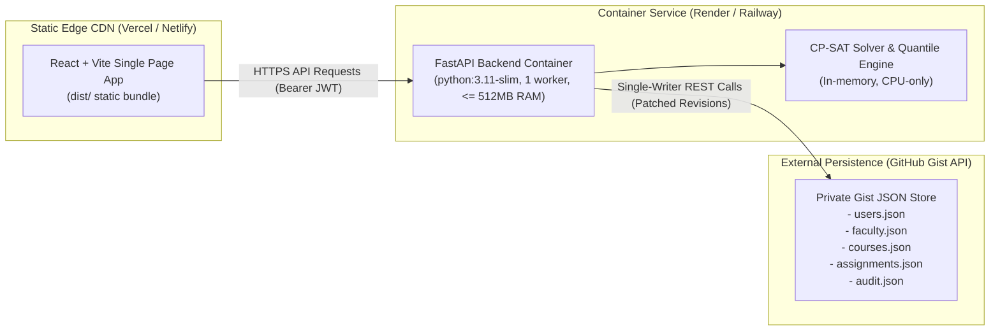

# Production Deployment Guide: Render, Railway, Vercel & Netlify

This guide details the complete production deployment procedures for the **University Faculty Workload & Course Assignment Balancing System**, including containerized backend deployment (Render/Railway), edge-cached frontend deployment (Vercel/Netlify), and an exhaustive environment variable reference.

---

## 1. Production Topology & Architectural Invariants



### 1.1 Mandatory Single-Writer Constraint
- **Why exactly 1 worker / 1 container instance?**: In production mode (`STORE_BACKEND=gist`), application state is persisted across versioned JSON files stored inside a designated private GitHub Gist. GitHub Gists do not provide distributed row-level locking or cross-process concurrency primitives. To prevent write races and lost updates, the backend must run with **exactly one worker process (`--workers 1`) on a single container instance**.
- **Memory Footprint**: Running a single Uvicorn worker process ensures the backend comfortably operates within the strict **512 MB RAM ceiling**.

---

## 2. Complete Environment Variable Reference

Configure these environment variables in your cloud hosting dashboards.

| Variable Name | Required | Default / Example | Target Service | Description & Operational Impact |
| :--- | :---: | :--- | :--- | :--- |
| `GIST_TOKEN` | **Yes** | `ghp_xxxxxxxxxxxxxxxxxxxx` | Backend | GitHub Personal Access Token (PAT) with `gist` scope used to read and commit data. |
| `GIST_ID` | **Yes** | `a1b2c3d4e5f6...` | Backend | ID of the private GitHub Gist housing system schemas (`users.json`, `faculty.json`, etc.). |
| `JWT_SECRET` | **Yes** | `min-32-chars-random-cryptographic-secret` | Backend | Secret key used to sign and verify HMAC-SHA256 JWT access and refresh tokens. |
| `STORE_BACKEND` | **Yes** | `gist` | Backend | Persistence driver. Set to `gist` for production (`local` uses disk JSON files). |
| `OTP_DEV_MODE` | **Yes** | `false` | Backend | Set to `false` in production. Disables in-memory OTP inspection and requires real SMTP delivery. |
| `FORECAST_MODE` | **Yes** | `precomputed` | Backend | **Critical for 512MB RAM**: `precomputed` drops LightGBM from memory and serves precomputed quantiles; `model` loads the booster. |
| `ALLOWED_ORIGINS` | **Yes** | `https://workload.university.edu,https://app.vercel.app` | Backend | Comma-separated list of allowed frontend origins for CORS. No wildcards when credentials are enabled. |
| `SMTP_HOST` | **Yes** | `smtp.sendgrid.net` | Backend | SMTP host for sending 6-digit one-time passcodes to faculty and department administrators. |
| `SMTP_PORT` | **Yes** | `587` | Backend | SMTP port (typically 587 for STARTTLS, 465 for SSL). |
| `SMTP_USER` | **Yes** | `apikey` | Backend | SMTP username / authentication account. |
| `SMTP_PASSWORD` | **Yes** | `SG.xxxxxxxxxxxxxxxxxxxx` | Backend | SMTP password or API token. (Alias `SMTP_PASS` is also recognized). |
| `SMTP_FROM` | No | `noreply@university.edu` | Backend | "From" sender address shown in faculty OTP emails. |
| `SMTP_TLS` | No | `true` | Backend | Enable STARTTLS encryption for outgoing SMTP dispatch. |
| `ENVIRONMENT` | No | `production` | Backend | Environment flag. Setting `production` enables strict cookie security (`secure=True`) and HSTS. |
| `PORT` | No | `8000` | Backend | Port on which Uvicorn listens. Injected automatically by Render/Railway. |
| `LOG_LEVEL` | No | `INFO` | Backend | Logging verbosity (`DEBUG`, `INFO`, `WARNING`, `ERROR`). |
| `RATE_LIMIT_PER_MINUTE` | No | `180` | Backend | Max requests per client IP per minute before returning HTTP 429 Too Many Requests. |
| `VITE_API_URL` | **Yes** | `https://workload-api.onrender.com/api/v1` | Frontend | Base URL of the deployed FastAPI backend v1 API. |

---

## 3. Backend Deployment: Render (Web Service)

Render provides lightweight container hosting with free SSL and automatic health checking.

### Step 1: Create Web Service
1. Log in to the [Render Dashboard](https://dashboard.render.com/) and click **New +** $\rightarrow$ **Web Service**.
2. Connect your GitHub repository.
3. Configure service parameters:
   - **Name**: `faculty-workload-api`
   - **Region**: Select region closest to your users (e.g., `Oregon (US West)` or `Frankfurt (EU Central)`).
   - **Branch**: `main`
   - **Root Directory**: Leave blank (uses repo root).
   - **Environment**: **Docker**.
   - **Dockerfile Path**: `backend/Dockerfile` (or root `Dockerfile`).
   - **Instance Type**: **Starter** or **Free** (512 MB RAM, 0.5 CPU).

### Step 2: Configure Health Check Path
Under **Advanced**:
- **Health Check Path**: `/health` (responds with HTTP 200 and system status).
- **Auto-Deploy**: `Yes`.

### Step 3: Enter Environment Variables
Add all backend variables from Section 2 in the **Environment** tab:
- `STORE_BACKEND`: `gist`
- `GIST_TOKEN`: `ghp_...`
- `GIST_ID`: `...`
- `JWT_SECRET`: `...`
- `OTP_DEV_MODE`: `false`
- `FORECAST_MODE`: `precomputed`
- `ENVIRONMENT`: `production`
- `ALLOWED_ORIGINS`: `https://your-frontend.vercel.app`
- `SMTP_HOST`, `SMTP_PORT`, `SMTP_USER`, `SMTP_PASSWORD`: (Your SMTP credentials)

Click **Create Web Service**. Render will build the slim Docker container and start serving.

---

## 4. Backend Deployment: Railway

Railway offers native Dockerfile builds with zero configuration.

### Step 1: Deploy from GitHub Repo
1. Open [Railway Dashboard](https://railway.app/) $\rightarrow$ **New Project** $\rightarrow$ **Deploy from GitHub repo**.
2. Select the repository.
3. In **Settings**:
   - **Build**: Select **Dockerfile**. Railway detects `backend/Dockerfile` or root `Dockerfile`.
   - **Replicas**: Maintain **1 replica** (mandated by the single-writer Gist contract).

### Step 2: Add Environment Variables
In the **Variables** tab of the service, enter:
- `STORE_BACKEND`: `gist`
- `GIST_TOKEN`: `ghp_...`
- `GIST_ID`: `...`
- `JWT_SECRET`: `...`
- `OTP_DEV_MODE`: `false`
- `FORECAST_MODE`: `precomputed`
- `ENVIRONMENT`: `production`
- `ALLOWED_ORIGINS`: `https://your-frontend.netlify.app`
- `SMTP_HOST`: `...`
- `SMTP_PORT`: `587`
- `SMTP_USER`: `...`
- `SMTP_PASSWORD`: `...`

### Step 3: Set Custom Domain & Health Check
- In **Settings** $\rightarrow$ **Networking**, click **Generate Domain**.
- Set **Healthcheck Path** to `/health`.
- Copy the public URL (e.g., `https://faculty-workload-production.up.railway.app`).

---

## 5. Frontend Deployment: Vercel

Vercel provides edge CDN delivery for Vite single-page applications.

### Step 1: Import Project
1. Log in to [Vercel](https://vercel.com/) and click **Add New...** $\rightarrow$ **Project**.
2. Select your repository.
3. In **Project Settings**:
   - **Framework Preset**: **Vite**.
   - **Root Directory**: Click edit and select `frontend`.
   - **Build Command**: `npm run build`
   - **Output Directory**: `dist`
   - **Install Command**: `npm install`

### Step 2: Set Environment Variables
Under **Environment Variables**:
- `VITE_API_URL`: `https://faculty-workload-api.onrender.com/api/v1` (your deployed backend URL + `/api/v1`).

### Step 3: Deploy & Verify
Click **Deploy**. Vercel uses `frontend/vercel.json` to configure client-side SPA routing (`/*` $\rightarrow$ `/index.html`) and HTTP security headers automatically.

---

## 6. Frontend Deployment: Netlify

### Step 1: Import Repository
1. Log in to [Netlify](https://app.netlify.com/) and click **Add new site** $\rightarrow$ **Import an existing project**.
2. Connect to GitHub and select the repository.

### Step 2: Configure Build Settings
- **Base directory**: `frontend`
- **Build command**: `npm run build`
- **Publish directory**: `frontend/dist`

### Step 3: Add Environment Variables
Under **Site configuration** $\rightarrow$ **Environment variables**:
- Key: `VITE_API_URL`
- Value: `https://faculty-workload-production.up.railway.app/api/v1`

Click **Deploy site**. Netlify utilizes `frontend/netlify.toml` for redirect rules (`/*` to `/index.html` with status 200).

---

## 7. Memory Budget & `FORECAST_MODE` Optimization

The backend is certified to operate within a **512 MB RAM footprint**.

### Mode A: `FORECAST_MODE=precomputed` (Recommended for Production)
- **Memory Footprint**: ~**65 MB – 95 MB RSS**.
- **Operation**: The backend skips loading `lightgbm` C++ booster models into process memory. Demand quantiles ($P_{10}, P_{50}, P_{90}$) are loaded directly from the term scenario JSON configurations.
- **When to use**: Highly recommended for standard cloud 512MB starter tiers to leave maximum headroom for the Google OR-Tools CP-SAT solver.

### Mode B: `FORECAST_MODE=model`
- **Memory Footprint**: ~**160 MB – 220 MB RSS**.
- **Operation**: Loads pre-trained booster models from `ml/artifacts/model.txt` at startup for ad-hoc runtime scoring of arbitrary unseen course features.
- **When to use**: When planners are introducing brand new courses not present in the precomputed scenario files.

---

## 8. Post-Deployment Verification Checklist

Once both services are running:

1. **Verify Backend Health**:
   ```bash
   curl -i https://your-backend-domain.com/health
   ```
   Must return HTTP `200 OK` with JSON containing `"status": "healthy"`, `"store_backend": "gist"`, and `"memory_budget_mb": 512`.

2. **Verify Security Headers**:
   ```bash
   curl -I https://your-backend-domain.com/health
   ```
   Check for headers:
   - `x-content-type-options: nosniff`
   - `x-frame-options: DENY`
   - `x-xss-protection: 1; mode=block`
   - `referrer-policy: strict-origin-when-cross-origin`

3. **Verify CORS**:
   ```bash
   curl -I -H "Origin: https://your-frontend-domain.com" \
        -H "Access-Control-Request-Method: POST" \
        https://your-backend-domain.com/api/v1/auth/request-otp
   ```
   Must return `access-control-allow-origin: https://your-frontend-domain.com` with `access-control-allow-credentials: true`.

4. **Verify Frontend Authentication**:
   - Visit `https://your-frontend-domain.com/login`.
   - Submit an institutional email (e.g., `admin@university.edu`).
   - Confirm delivery of the 6-digit passcode to the email inbox via configured SMTP.
   - Enter passcode, confirm redirect to `/admin` dashboard.

