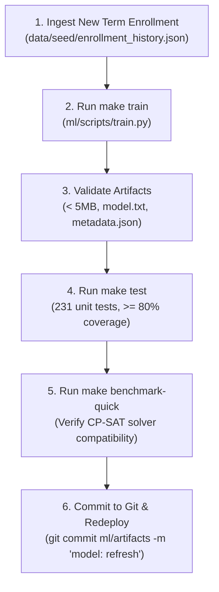

# Model Refresh Runbook: Offline Training & Deployment

This runbook documents the standard operating procedure (SOP) for updating the Section Demand Quantile Forecaster when a new academic term concludes and fresh historical enrollment data becomes available.

---

## 1. Architectural Guardrails (Mandatory)

In strict accordance with [`AGENTS.md`](file:///e:/AI%20project/AGENTS.md) and [`PROJECT_BRIEF.md`](file:///e:/AI%20project/docs/PROJECT_BRIEF.md):

> [!CAUTION]
> **Strict Training vs. Inference Decoupling**
> The live production backend server **NEVER** trains machine learning models. The backend operates with a strict 512 MB RAM ceiling and no GPU. All model training is executed **offline** on a developer workstation or dedicated CI runner, and only serialized artifacts are committed and deployed.

### Core Model Constraints:
1. **CPU-Only**: Training and inference rely exclusively on `lightgbm`, `scikit-learn`, `numpy`, and `pandas`. No PyTorch, TensorFlow, or CUDA.
2. **Safe Serialization**: Models are saved strictly in LightGBM native text format (`model.txt`). Metadata and metrics are saved as human-readable `.json`. **Never use `pickle` or `joblib`**.
3. **Artifact Size Limit**: All committed artifacts in `/ml/artifacts` must remain strictly **< 5 MB** per file.
4. **Constrained Hyperparameters**:
   - `n_jobs=1`
   - `num_leaves <= 15`
   - `n_estimators <= 300`
   - Fixed `random_state=42` for deterministic reproducibility.

---

## 2. Standard Operating Procedure (SOP)



---

### Step 1: Update Enrollment History

Append newly completed term records to [`data/seed/enrollment_history.json`](file:///e:/AI%20project/data/seed/enrollment_history.json).

Each record must conform to the following schema:
```json
{
  "course_id": "CS-101",
  "term_index": 10,
  "term_name": "2026-Fall",
  "season": "Fall",
  "enrolled_count": 94,
  "section_cap": 30,
  "credits": 3.0,
  "is_lab": false,
  "level": "undergraduate"
}
```

Verify that:
- `term_index` increments chronologically.
- `enrolled_count` reflects official census day student counts.
- JSON syntax is valid (`python -m json.tool data/seed/enrollment_history.json > /dev/null`).

---

### Step 2: Execute Offline Model Training

Run the offline training script via the project Makefile:

```bash
make train
```

Under the hood, this executes:
```bash
python ml/scripts/train.py
```

The script will:
1. Load historical enrollment records and compute lag/rolling features (`lag1_enrolled`, `lag2_enrolled`, `rolling3_mean`, etc.).
2. Fit three separate LightGBM quantile regressors for **P10 ($\alpha = 0.10$)**, **P50 ($\alpha = 0.50$)**, and **P90 ($\alpha = 0.90$)**.
3. Evaluate pinball loss and quantile coverage calibration across validation folds.
4. Serialize trained boosters to `ml/artifacts/model.txt`.
5. Output training metrics to `ml/artifacts/metrics.json` and config to `ml/artifacts/metadata.json`.

---

### Step 3: Validate Generated Artifacts

Inspect the generated artifacts in `ml/artifacts/`:

```bash
ls -lh ml/artifacts/
```

Check:
1. `model.txt` exists and is formatted as native LightGBM text format (not binary/pickle).
2. File size is well below 5 MB (typically ~**120 KB – 350 KB**).
3. Review `ml/artifacts/metrics.json`:
   - P10 empirical coverage is approximately 10% ($\pm 4\%$).
   - P50 pinball loss is within historical tolerance ($< 6.5$ students).
   - P90 empirical coverage is approximately 90% ($\pm 4\%$).
   - Monotonicity check ($P_{10} \le P_{50} \le P_{90}$) passes for 100% of samples.

---

### Step 4: Run Test Suite & Reproducibility Check

Ensure the refreshed model artifacts do not break existing backend services or solver contracts:

```bash
make test
```

Verification requirements:
- All 231 tests pass with 0 failures.
- Execution completes within the **< 2 minutes** budget (typical: ~38 seconds).
- Module coverage remains **$\ge 80\%$** across `constraint_engine.py`, `security.py`, `auth.py`, and `repositories`.
- Solver reproducibility tests (`test_reproducibility.py`) confirm deterministic results.

---

### Step 5: Run Quick Optimizer Benchmark

Verify that solver trade-offs and runtime limits remain healthy:

```bash
make benchmark-quick
```

Confirms:
- CP-SAT solver finds feasible solutions within the 10s limit.
- Peak memory stays $< 1.0$ MB.
- Updated markdown table rendered at `docs/benchmark.md`.

---

### Step 6: Commit Artifacts & Trigger Deployment

Commit the updated artifacts to version control:

```bash
git add data/seed/enrollment_history.json ml/artifacts/
git commit -m "ml(artifacts): refresh demand forecast models for [Term Name]"
git push origin main
```

Upon pushing to `main`:
1. **GitHub Actions CI** triggers automatically (`.github/workflows/ci.yml`), running lint, unit tests with coverage, frontend build, Playwright E2E, and the quick benchmark.
2. Once CI passes, **Render** or **Railway** automatically redeploys the backend container with the updated `model.txt`.

---

## 3. Rollback Procedure

If the refreshed model demonstrates quantile drift, excessive pinball loss, or unexpected section over-allocation in staging:

1. Revert the Git commit:
   ```bash
   git revert HEAD
   git push origin main
   ```
2. Or immediately set the backend environment variable:
   ```bash
   FORECAST_MODE=precomputed
   ```
   This directs the backend to use deterministic, precomputed baseline sections from the scenario files while bypassing runtime model inference entirely.

